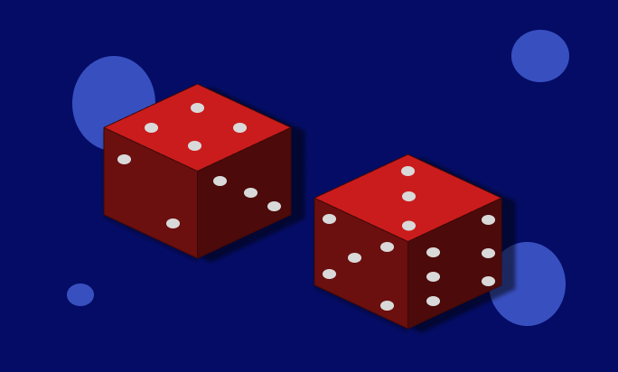

# Two Dice Done Rigorously: Sigma-Algebras, Pushforward Measures, Random Variables, and Why 7 Wins (Part 1 of 3)

In this series, we will rigidly define the probability space and random variable required to show why 7 wins when summing the result of rolling two 6-sided dice. Note that we are assuming both the dice are fair, the odds of landing on any of the faces is equal to landing on any of the others. The purpose here isn’t to rehash this common example (7 wins because it has the most ways to make the sum with two dice). Rather, we are going to go from start to finish in a measure-theoretically sound approach to learn about the roles that sigma algebras, pushforward measures, and random variables play in statistics. Starting with this example allows us to keep things relatively simple.
## Why dice rolls?
There are two main reasons we are using dice rolls as our example. The first is that rolling two dice and summing the resulting values they take is a classic example used in probability textbooks and classes, so it is familiar. The deeper reason, which we will expand on in this article, is the fact that we have a countable set of outcomes. This will allow us to define the components we need in a much more intuitive manner than an experiment with an uncountable set of outcomes. Don’t worry, we will see this play out in the article.
## The Probability Tuple (A.K.A. Probability Space)
In this section we will define and examine the “Probability Space”. The Probability Space is the 3-tuple:
$$
(\Omega,\mathcal{F},\mathcal{P})
$$
*Figure 1*

where we have:
$$
\begin{aligned}
&\Omega:\text{ The sample space}\\
&\mathcal{F}:\text{ The event space}\\
&\mathcal{P}:\text{ The probability measure}
\end{aligned}
$$
*Figure 2*

Below, we will look into each of these three elements more deeply.

### The Sample Space
The Sample Space is a set. Specifically, it is a set that contains all the possible outcomes of the experiment that we want to do probability on. Usually, the first sample space we see when first learning statistics and probability is the sample space of a single coin flip:
$$\{H,T\}$$
*Figure 3*

This sample space only has two elements, is easy to write out, and has a baked in probability measure when we are using a fair coin (each outcome occurs with a 50 percent chance). Note here that our sample space does NOT need to contain numbers.

In the case of our experiment, we have a sample space that is comprised of numbers. This quality is not required though. In the case of rolling two dice, we end up having two values in each run of our experiment: the value of the first die, and the value of the second die. We represent the set of all possible values using this set:
$$\Omega=\{(i,j):i,j\in\{1,2,3,4,5,6\}\}$$
*Figure 4*

This is the first component of our probability tuple. What we have here is “the set of all tuples of two numbers, such that each number takes a value of 1, 2, 3, 4, 5, or 6.”

Why don’t we just write all the possible outcomes out? We could, and in this case specifically it wouldn’t be too hard. With two dice we have 36 possible outcomes: there are 6 ways to roll the first die, and 6 ways to roll the second die for each of the first die rolls, giving us 6x6=36 total entries. Our set in Figure 4 captures this. However, imagine if we wanted to write the sample space of an experiment where we roll 10 dice, in that case we would have 6¹⁰ different possible outcomes, and each one would have 10 elements in it.
### The Event Space (hint: it’s a sigma-algebra)
With our sample space in hand, we now move on to the second element in our probability tuple: the Event Space. The event space is comprised of all the “events” that we are going to allow to be measured in our experiment. The events are sets comprised of elements from our sample space. Using our sample space in Figure 4, some possible events we have in our event space are:
$$
\begin{aligned}
\{(1,2)\}&\in\mathcal{F}\\
\{(1,1),(4,5)\}&\in\mathcal{F}\\
\{(1,1),(2,3),(6,5),(5,6)\}&\in\mathcal{F}
\end{aligned}
$$
*Figure 5*

A very important note: the sample space is a set of outcomes of our experiment. In contrast, the event space is a set of sets of outcomes of our experiment. So:
$$
\text{while }\{(1,2)\}\in\mathcal{F},\ (1,2)\text{ is NOT an element of }\mathcal{F}
$$
How we decide to define this event space has some flexibility, but there is a rule that must followed: the event space MUST be a sigma algebra on our sample space. But wait, what is a sigma algebra?

Let $X$ be some set, let $2^X$ be the power set of $X$. A subset of this power set, $\Sigma \subseteq 2^X$ is called a $\sigma$-algebra if the following three conditions hold:
	- $X\in \Sigma$
	- $\Sigma$ is closed under complementation. i.e. if $A\in \Sigma$ then $A^c\in \Sigma$ .
	- $\Sigma$ is closed under countable union: if $A_1, A_2, A_3\dots \in \Sigma$ then $A_1\cup A_2\cup A_3\cup\dots \in \Sigma$

*Figure 6*

Figure 6 has the rules that a subset of a powerset must be adhere to in order to be called a sigma algebra. The simplest sigma algebra that we can have on a set (sometimes referred to as the “trivial” sigma algebra) is:

The simplest sigma algebra is $\{X, \emptyset\}$
	- first condition holds trivially
	- second condition holds since $X^c=\emptyset$ and $\emptyset^c = X$ 
	- the third condition holds since any union we can even make is a combination of $X$ and $\emptyset$, which will equal either $X$ or $\emptyset$, both of which are included in our sigma algebra

*Figure 7*

Notice that all three conditions are adhered to, so we have a sigma algebra. For the purpose of probability however, the trivial sigma algebra is more or less useless. Figure 7 is included to build intuition of the sigma algebra as a concept. So what is our event space then? Notice in the definition for sigma algebra we have
$$
\Sigma\subseteq2^X
$$

In the case of our probability space, the set that we are using as input to the powerset operation is our sample space, and the sigma algebra we are trying to build is our event space. So let’s change our symbols to the ones we are actually working with in this article:
$$
\mathcal{F}\subseteq 2^\Omega
$$
*Figure 8*

At this point all we know is that our event space is a sigma algebra, and that our event space is a subset that is possibly equal to the powerset of our sample space. Remember at the start of this article when we said:

“The deeper reason, which we will expand on in this article, is the fact that we have a countable set of outcomes. This will allow us to define the components we need in a much more intuitive manner than an experiment with an uncountable set of outcomes. Don’t worry, we will see this play out in the article.”

Here is the part where we see that play out. It turns out, if our sample space is countable, then we can use the powerset itself as our event space! This fact is one of the reasons we have chosen the sum of two dice rolls. (Note that things are more complicated if our sample space is uncountable, but that is out of scope for this article. For the curious reader, we would need a more specific sigma algebra for our event space and would likely use a “borel sigma algebra”).

With this useful fact we can now define our event space as:
$$
\mathcal{F}=2^\Omega
$$
*Figure 9*

Since we have the entire powerset as our event space, and the powerset contains every possible subset of our sample space, we have that the three conditions required for sigma algebra hold.

### The Probability Measure
A lingering question we have at this point is “why are we doing all of this setup?” The short answer: math requires precision. The long answer: we need something called “measurability” to make a probability space. When we are concerning ourselves with probability, we are implicitly trying to measure how likely something is to happen. There is entire branch of mathematics called measure theory that we get to borrow from when defining our framework for probability. In fact, when we combine a set, and a sigma algebra on that set, we have what’s called a “measurable space”. In the context of this article, we’ve done just that: our set is the sample space, and our sigma algebra is the event space. Those two things together form a measurable space:

$$
(\Omega,\mathcal{F})
$$
*Figure 10*

a measurable space is named as such because it’s a mathematical space that we can assign a “measure” to. See, it turns out that without the requirements of a sigma algebra, we can have the issue of trying to measure sets in a manner that either doesn’t work at all, or isn’t useful. A measurable space is called that because it has the mathematical pieces in place needed to put the final piece of the puzzle: a measure.

A measure is a function that goes from our sigma algebra to the interval:
$$
\mu:\Sigma\rightarrow[0,\infty]
$$
*Figure 11*

Intuitively the codomain makes sense. We want the measure to be nonnegative. If we asked the question, “what is the distance between two atoms?” even though the answer is very (very) tiny, it is definitely not negative. The question of whether or not something can have a measure of infinity is perhaps a little less intuitive. A question that helps us see why infinity is included as a valid measure output, “How many natural numbers are there?” in other words, “What is the measure of the set of natural numbers?” The answer: infinity.

Measures work on sets. In fact, the elements of a sigma algebra are themselves called measurable sets for this reason: when we make a sigma algebra we are saying, “these are the sets we are measuring.” Similar to sigma algebras, measures have rules as well. The two rules that a measure must adhere to are:
$$
\begin{aligned}
&1.\ \mu\left(\bigcup_{i=1}^\infty A_i\right)=\sum_{i=1}^\infty\mu(A_i)\text{ where all }A_1,A_2\dots\in\Sigma\text{ are pairwise disjoint}\\
&2.\ \mu(\emptyset)=0
\end{aligned}
$$
*Figure 12*

Rule 2 is easy: the measure of the empty set is 0. This makes sense since the empty set, by definition, contains nothing. The first rule is saying that if we have a countable number of measurable sets from our sigma algebra, even if we have a countably infinity number, AND all of the sets are pairwise disjoint, we can measure the union of all of the sets and this will be equal to taking the sum of the measure of each set.

Once we have a measure, whatever that measure is, we can add it to our measurable space to make a measure space:
$$
(X,\Sigma,\mu)\text{ where }
$$
$$
\begin{aligned}
&X:\text{ is the underlying set}\\
&\Sigma:\text{ is a sigma algebra on the set }X\\
&\mu: \text{ is a measure}
\end{aligned}
$$
*Figure 13*

Wait a moment, when is the probability of anything ever more than 1? That is the last question we need to address for part 1 of this three-part series. The section above describes measures, which can take on values larger than 1. BUT, we are dealing with probability, so we use a special kind of measure: a probability measure.

A probability measure is a measure itself, but with an added rule that ensures we never have an event with a probability greater than 1 (which would be nonsensical). The rules that a probability measure must adhere to are:
$$
\begin{aligned}
&1.\ \mathcal{P}\left(\bigcup_{i=1}^\infty E_i\right)=\sum_{i=1}^\infty\mathcal{P}(E_i)\text{ where all }E_1,E_2\dots\in\mathcal{F}\text{ are pairwise disjoint}\\
&2.\ \mathcal{P}(\emptyset)=0\\
&3.\ \mathcal{P}(\Omega)=1, \text{ the measure of the sample space is } 1\\
&4.\ \mathcal{P}:\mathcal{F}\rightarrow[0,\infty]\text{ (it's a measure and therefore nonnegative)}
\end{aligned}
$$
*Figure 14*

Rules 1 and 2 are the same as rules 1 and 2 from figure 12. All we’ve done is use the symbols for our probability space and event space, and the letter E for events. Rule 3 is the added requirement that makes this bound possible. Here we require that the probability measure value of our sample space is 1. Recall that any sigma algebra of any set is a subset of the powerset. This directly implies that the largest element in any sigma algebra is the underlying set itself. In the case of a probability space, the sigma algebra at play is our event space, and the underlying set is the sample space. This means that the largest set in our event space is the sample space itself, and since we say that has a probability measure of 1, any other event must be less than or equal to that.

Thinking about the above paragraph intuitively, this makes sense. We are saying that the chances of at least 1 outcome of our experiment happening are 1 out of 1, which is trivially true. If it were the case that we could run the experiment and NOT get an outcome from our sample space, then we need to add whatever happened to the sample space, or disregard that specific experiment run (for example, if a coin lands on its side, we often say that doesn’t count).