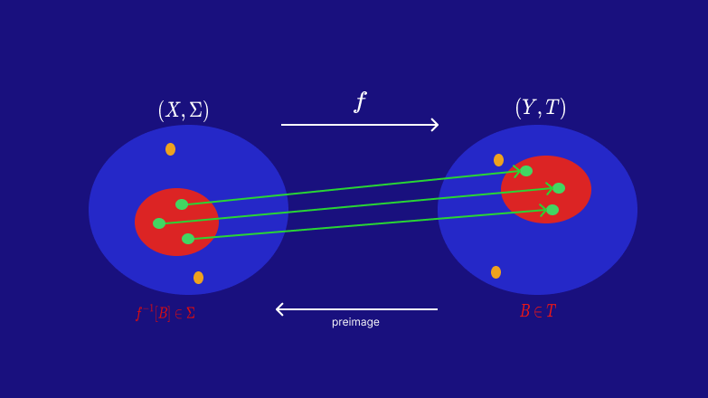

# Two Dice Done Rigorously: Sigma-Algebras, Pushforward Measures, Random Variables, and Why 7 Wins (Part 2 of 3)

*This is the second article in a three-part series. I highly recommend reading the first installment to have the context needed for this article: https://medium.com/@mckenzieben15/two-dice-done-rigorously-sigma-algebras-pushforward-measures-random-variables-and-why-7-wins-0379d5513631*

In this second installment, we will be examining the topics of measurable functions and random variables, show why textbooks say a random variable is a measurable function, and define our random variable for our dice rolls and sum experiment.

## Brief Recap
In the previous article, we went through the steps to formally define a probability space. We defined our sample space, our event space, and our probability measure. We learned that a probability space is a measure space i.e. it is a measurable space equipped with a measure, specifically our probability measure. We showed how the rules of a probability measure prevent any event from our event space from having a probability greater than 1.

## Picking up: Making a Function Explicit
We have an intuitive notion of what a function is, but for this article series we will need to make things explicit and rigid. A function takes the following form:
$$
X:A\rightarrow B,\ X(a\in A)=b\in B
$$
*figure 1*

to define a function we need three things:
- 1. The domain: our possible input values
- 2. The rule: what our function actually does (for example, adding two dice rolls together)
- 3. The codomain: a set that is large enough to contain every possible output we think our function will produce

### Step 1: Identify Our Domain
In this experiment, we are adding the result of two dice rolls together. In our case, we want the domain of our function to be the sample space of our experiment:
$$
\Omega=\{(i,j):i,j\in\{1,2,3,4,5,6\}\}
$$
*figure 2*
### Step 2: Identify our Rule
The rule is what we want our function to do to elements in our domain. Since we are adding the result of rolling two dice together, our rule is then:
$$
X((i,j))=i+j
$$
*figure 3*
### Step 3: Identify our Codomain
We need a set that is large enough to contain the result of applying our rule from step 2 to every element in our domain. In this case, we know that adding two natural numbers together will result in a natural number. This means using the set of natural numbers will definitely contain all the possible outputs of our rule from step 2. Our codomain can then be stated as:
$$
\mathbb{N}
$$

One note here: we only require that the codomain is big enough. The natural numbers are an intuitive choice here, but it is equally valid to select the integers, rational numbers, real numbers, or even the set of complex numbers.
### The Range of a Function
We have the codomain of our function, but it is often useful to determine the *range* of our function. The range of a function is the set of possible values that the function can take. The range is a subset of the codomain. We obtain the range by applying our rule to every element of our domain. Using the following symbol for an element of our domain:
$$
\omega=(i,j)\in\Omega
$$
*figure 4*

We can define our range as:
$$
\begin{aligned}
R(X)&:=\{X(\omega):\omega\in\Omega\}\\
R(X)&=\{2,3,4,5,6,7,8,9,10,11,12\}\\
&\text{Note that } R(X)\subseteq \mathbb{N}
\end{aligned}
$$
*figure 5*
### Tying it together
With the 3 steps above concluded, we can tie everything together and formally state our function as:
$$
X:\Omega\rightarrow \mathbb{N},\ X((i,j)\in \Omega)=i+j
$$
*figure 6*

with the range of our function described in figure 5.

That was quite a bit for the start of an article! But, defining these things rigidly will help in the following sections, and allow us to gain a deep understanding of what a random variable is.
## Preimages
To move forward with this process, we need to learn about measurable functions. At a high level, a measurable function is simple: *a measurable function is a function from one measurable space to another measurable space that preserves the structures of the two spaces.* This definition is incomplete, and not very helpful for understanding measurable functions. We need to dig deeper.

First, we need to define a concept known as the “preimage” of a set given a function:
$$
\text{Let } f:X\rightarrow Y \text{ be a function from the set }X \text{ to the set }Y.\\ \text{ The preimage of a subset of }Y,B\subseteq Y, \text{ is the set: }\\
f^{-1}[B]=\{x\in X:f(x)\in B\}
$$
*figure 7*

An example might make this easier to understand. First, let's define a function in the manner that we have described above:
$$
\begin{aligned}
\text{Let }f:\mathbb{Z}\rightarrow\mathbb{Z},\text{ where }f(x\in\mathbb{Z})=x^2
\end{aligned}
$$
*figure 8*

We can compute some preimages as follows:
$$
\begin{aligned}
A=&\{4, 9\}\subseteq\mathbb{Z}.\ f^{-1}[A]=\{x\in\mathbb{Z}:f(x)\in A\}\\
&\text{so } f^{-1}[A]=\{-2, 2, -3, 3\}\\
B=&\{25\}\subseteq \mathbb{Z}.\ f^{-1}[B]=\{x\in \mathbb{Z}:f(x)\in B\}\\
&\text{so } f^{-1}[B]=\{-5, 5\}\\
C=&\{2, 16\}.\  f^{-1}[C]=\{x\in \mathbb{Z}:f(x)\in C\}\\
&\text{so }f^{-1}[C] = \{-4,4\}
\end{aligned}
$$
*figure 9*

An important note to make regarding figure 9 can be seen in the third preimage example. Since our domain and codomain are both integers, even though
$$
C=\{2,16\}
$$
there is no integer that can be squared to equal 2:
$$
\nexists\ i\in\mathbb{Z}:i^2=2
$$
That is why we don't include it in our preimage. Another way to look at this is:
$$
f^{-1}[\{2\}]=\emptyset
$$

## Measurable Functions

This section will cover what a measurable function is. We will start with the formal definition of measurable function and break it down.

$$
\text{Formally, we define a measurable function as follows: let } (X,\Sigma)\text{ and } (Y,T)\text{ be two measurable}\\
\text{spaces. A function, }f:X\rightarrow Y\text{ is said to be measurable if for every element of the sigma}\\
\text{algebra }T\text{, the preimage of that element under }f\text{ is an element of the sigma algebra }\Sigma.\\
\text{i.e. }f^{-1}[t]\in\Sigma, \forall t\in T
$$
*figure 10*

Don't worry if this seems complicated. Some break down will make things more apparent. First, note the fact that a measurable function is called a *measurable* function and as we learned from part 1 of this series, a *measurable space* is a set equipped with some sigma algebra. This gets us through the statement:
$$
``\text{let }(X,\Sigma)\text{ and }(Y,T)\text{ be two measurable spaces.}"
$$
*figure 10.1*

Next, we have:
$$
``\text{A function, }f: X\rightarrow Y\text{ is said to be measurable...}"
$$
*figure 10.2*

We know the rigid definition of function from this article. In figure 10.2 the portion "*is said to be measurable*" is what we are actively defining, so we don't need to dig deeper on this part.

The next part of the definition reads:
$$
``\text{if for every element of the sigma}
\text{ algebra }T\text{, the preimage of that}\\
\text{element under }f\text{ is an element of the sigma algebra }\Sigma."
$$
*figure 10.3*

We know what preimages are from this article. We also know that the elements of a sigma algebra are sets. So, Figure 10.3 is saying that we need every element contained in the destination's sigma algebra to have its preimage in the source's sigma algebra.

Finally, we simply state what we have above in mathematical symbols:

$$
``f^{-1}[t]\in\Sigma, \forall t\in T"
$$
*figure 10.4*

One thing to note about measurable functions here, we need the attached sigma algebras for the measurable functions to make sense. Since the sigma algebras are inherently tied to the measurable function, we include those in our notation. Using the same symbols as our formal definition in Figure 10, we would notate our measurable function as:
$$
f:(X,\Sigma)\rightarrow(Y,T)
$$
*figure 11*
## Measurable Functions (Visually)
The following image provides a visualization of a measurable function:

*Figure 12*

In this image we have the components of a measurable function. In white, we have our sigma algebras, the function between the two, and our preimage direction. The blue circles represent some part of our base sets. The red circles are the specific sets we are current mapping. The green dots are points in the sets we are currently mapping, and the orange dots simply represent points in our base sets. Finally, in red text we have the mathematical symbols for our image and preimage.
## The Random Variable
The reason we have gone through so much effort to define sigma algebras, probability spaces, and now measurable functions is to make the concept of the random variable easier to understand.

Recall from the previous article in this series that a probability space is the tuple:
$$
(\Omega,\mathcal{F},\mathcal{P})
$$
*Figure 13*

where we have:
$$
\begin{aligned}
&\Omega:\text{ The sample space}\\
&\mathcal{F}:\text{ The event space}\\
&\mathcal{P}:\text{ The probability measure}
\end{aligned}
$$
*figure 14*

**Here is where some care is needed.** Let’s start with the formal definition of a random variable (don’t worry, the point of this section is to demystify this):

$$
\begin{aligned}
&\text{Let }(\Omega, \mathcal{F}, \mathcal{P})\text{ be a probability space and }(E,\mathcal{E})\text{ a measurable space. Then, an}\\
&(E,\mathcal{E})-\textbf{valued random variable }\text{ is a measurable function }X:(\Omega,\mathcal{F})\rightarrow(E,\mathcal{E})
\end{aligned}
$$
*Figure 15*

First off, pat yourself on the back for getting this far! We already know what a measurable function is, so we can check that box. The next question is what the *measurable spaces* of both the domain and codomain are. We already have the domain covered from the first article in this series: *the domain of the random variable is the measurable space of our probability tuple.* All we need to do is drop our probability measure (for now), making a *measurable space*, and we have that covered. **So what is the codomain?**

The codomain of a random variable, in general, has two requirements:

1. The codomain of our random variable needs to be a *measurable space*. This requirement, on it’s own, is pretty easy to understand given what we learned from the previous article in this series: *a measurable space is a set, together with a sigma algebra.* If we examine the definition of random variables given in figure 15, the measurable space our random variable’s codomain has is:
$$
(E,\mathcal{E})
$$
*figure 16*

2. Since a random variable is a measurable function, we need to adhere to:
$$
\text{Formally, we define a measurable function as follows: let } (X,\Sigma)\text{ and } (Y,T)\text{ be two measurable}\\
\text{spaces. A function, }f:X\rightarrow Y\text{ is said to be measurable if for every element of the sigma}\\
\text{algebra }T\text{, the preimage of that element under }f\text{ is an element of the sigma algebra }\Sigma.\\
\text{i.e. }f^{-1}[t]\in\Sigma, \forall t\in T
$$
*Figure 10 (again)*

Tying this all together, our random variable allows us to go from the original probability space, to a new one. That new probability space is “induced” by our random variable. Right now, everything is abstract (all the symbols we’ve been using). We can make things concrete with our dice roll experiment.

## Making Our Random Variable Concrete

Let's tie this back to our example. We roll two dice, making our sample space:
$$
\Omega=\{(i,j):i,j\in\{1,2,3,4,5,6\}\}
$$
*Figure 17*

We create the event space (which is also a sigma algebra) using the powerset operation:
$$
\mathcal{F}=2^\Omega
$$
*Figure 18*

This makes the domain of our random variable:
$$
(\Omega,\mathcal{F})
$$

Recall that we have three components in a "normal" function: the domain, the codomain, and the rule. Let's define each for the random variable specific to our dice roll experiment:
- Domain: the domain of our underlying function has been stated, it is the sample space, $\Omega$
- Rule: the rule here is we add the resulting values of two dice rolls. In mathematical symbols we can state our rule as $X((i,j))=i+j$
- Codomain: we can choose any set that is big enough, but an intuitive choice ends up being the natural numbers, since we only have positive whole numbers on the faces of the two dice, and we are simply adding them. That makes our codomain $\mathbb{N}$

With the points above, we can state the underlying "normal" function that our random variable will be built from as:
$$
X:\Omega\rightarrow\mathbb{N},\ X((i,j)\in\Omega)=i+j
$$
*Figure 19*

That just leaves the codomain of our random variable. We are using the natural numbers as the codomain of our underlying function, so a natural (no pun intended) choice for the sigma algebra of our random variable's codomain is the powerset. This yields the codomain as:
$$
(\mathbb{N}, 2^\mathbb{N})
$$
*Figure 20*

This makes the formal definition of our random variable:
$$
X:(\Omega,\mathcal{F})\rightarrow(\mathbb{N}, 2^\mathbb{N}),\ X((i,j)\in\Omega)=i+j
$$
*Figure 21*

But we require measurablility!  Fortunately, the proof that our proposed random variable in figure 21 is in fact a measurable funciton is straightforward.

### Proof of Measurablility
To show that our random variable is measurable, we use the following proof:
$$
\begin{aligned}
&\text{Claim: }X:(\Omega,\mathcal{F})\rightarrow(\mathbb{N}, 2^\mathbb{N}),\ X((i,j)\in\Omega)=i+j\text{ is a measurable function}\\
\text{Proof:}\\
1.\ &\text{Let }B\in2^\mathbb{N}\text{ be arbitrary. By figure 7, }X^{-1}[B]=\{\omega\in\Omega:X(\omega)\in B\}\\
2.\ &\text{Trivially, every element of the set constructed in 1 is an element of }\Omega\\
3.\ &\text{Via 1 and 2 we have }X^{-1}[B]\subseteq\Omega\\
4.\ &\text{Since }\mathcal{F}=2^\Omega\text{ and via 3 we know }X^{-1}[B]\subseteq\Omega\text{, we also know }X^{-1}[B]\in\mathcal{F}\\
5.\ &\text{Finally, since our choice of }B\text{ was arbitrary, we know that every element}\\
&\text{of }2^\mathbb{N}\text{ has its preimage in }\mathcal{F}\text{. This is exactly the condition we need to}\\
&\text{satisfy for measurablility, therefore our random variable is measurable}
\end{aligned}
$$

*Figure 22*

### Example to Help
The following might help solidify these concepts. First, let's list our sample space out:

$$
\begin{array}{c|cccccc}
 & \mathbf{1} & \mathbf{2} & \mathbf{3} & \mathbf{4} & \mathbf{5} & \mathbf{6} \\
\hline
\mathbf{1} & (1,1) & (1,2) & (1,3) & (1,4) & (1,5) & (1,6) \\
\mathbf{2} & (2,1) & (2,2) & (2,3) & (2,4) & (2,5) & (2,6) \\
\mathbf{3} & (3,1) & (3,2) & (3,3) & (3,4) & (3,5) & (3,6) \\
\mathbf{4} & (4,1) & (4,2) & (4,3) & (4,4) & (4,5) & (4,6) \\
\mathbf{5} & (5,1) & (5,2) & (5,3) & (5,4) & (5,5) & (5,6) \\
\mathbf{6} & (6,1) & (6,2) & (6,3) & (6,4) & (6,5) & (6,6) \\
\end{array}
$$
*figure 23*

Next, here is a minor quiz (it's not graded don't worry). This will help us understand what is happening here. What are the preimages of the following sets of natural numbers? 
$$
\begin{aligned}
&A = \{1\}\\
&B = \{2,3\}\\
&C = \{\}\\
&D = \{4, 452\}
\end{aligned}
$$
*Figure 24*

Are you ready? And the answer is.... **Pando** Wait no sorry that's the largest living organism by mass in the US (he's a massive clonal tree, basically a single tree that is also a forest) The *actual* answer is:
$$
\begin{aligned}
&X^{-1}[A]=\emptyset\\
&X^{-1}[B]=\{(1,1),(1,2),(2,1)\}\\
&X^{-1}[C]=\emptyset\\
&X^{-1}[D]=\{(1,3),(2,2),(3,1)\}
\end{aligned}
$$
*Figure 25*

Notice for an empty set from our codomain sigma algebra, the preimage is simply the empty set. For a natural number that is a valid sum of two dice, we have every combination of rolls from our sample space which sums to that natural number, and if we have multiple valid natural numbers we simply include all those dice rolls in the preimage. Finally, notice that if we have a set of natural numbers with a mix of valid and invalid, we only have to care about the valid sum numbers since those that are invalid lead to the empty set as their preimage.